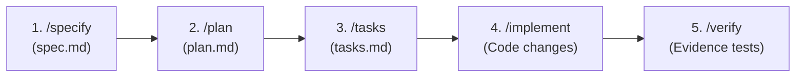

When `buddhi init` prepares a workspace, it scaffolds a production-grade **agent harness** under `.agents/`. This transforms Google Antigravity into an autonomous yet disciplined engineering team operating under the **Spec-Driven Development (SDD)** lifecycle.

---

## The Harness Directory Layout

```text
.agents/
├── mcp_config.json             # Workspace MCP connection to buddhi-mcp
├── workflows/                  # Slash command workflow instructions
│   ├── ask.md                  # /ask - Codebase Q&A grounded in code graph
│   ├── specify.md              # /specify - Feature specification
│   ├── plan.md                 # /plan - Architectural design
│   ├── tasks.md                # /tasks - User-story task breakdown
│   ├── implement.md            # /implement - Phased task execution
│   ├── verify.md               # /verify - Evidence-based test validation
│   ├── quick-plan.md           # /quick-plan - Lightweight planning
│   ├── document-codebase.md    # /document-codebase - OKF doc generator
│   ├── debug.md                # /debug - Root-cause investigation
│   ├── remember.md             # /remember - Memory capture
│   └── status.md               # /status - Harness dashboard
├── agents/                     # Specialist subagent definitions
│   ├── backend-specialist.md
│   ├── frontend-specialist.md
│   ├── database-specialist.md
│   ├── testing-specialist.md
│   ├── security-specialist.md
│   ├── deployment-specialist.md
│   ├── git-specialist.md
│   └── terminal-runner.md
├── rules/                      # Always-on guidelines
│   ├── harness-core.md         # MCP/graph consultation priority
│   └── okf-docs.md             # OKF document formatting rules
├── hooks.json                  # Lifecycle hook registration
├── hooks/
│   └── guard_destructive.py    # Mechanical safety guard against destructive commands
└── memory/
    ├── MEMORY.md               # Memory index
    ├── user-preferences.md
    ├── project-conventions.md
    └── tech-decisions.md
```

---

## Spec-Driven Development (SDD) Lifecycle

The SDD lifecycle ensures that features are specified, planned, broken down, implemented, and verified in orderly increments before code is finalized.



### 1. `/specify` — Specification Phase
- Scaffolds a feature branch and creates `.buddhi/specs/<branch>/spec.md`.
- Gathers requirements interactively.
- Defines prioritized, independently testable user stories (`P1` MVP, `P2`, `P3`...).
- Formulates acceptance scenarios using **Given / When / Then** syntax.

### 2. `/plan` — Architecture & Planning Phase
- Evaluates `spec.md` and initializes `plan.md`.
- Dispatches domain specialists in parallel (e.g. backend, database, frontend) to inspect existing code.
- Grounded in `AGENTS.md` rules and `.buddhi/docs/`.
- Documents technical choices, dependencies, and file structures.

### 3. `/tasks` — Task Breakdown Phase
- Converts `spec.md` and `plan.md` into actionable tasks in `tasks.md`.
- Groups tasks by user story (`[US1]`, `[US2]`) and marks independent steps with `[P]` for parallelism.
- Establishes clear test checkpoints.

### 4. `/implement` — Implementation Phase
- Verifies prerequisites using `buddhi sdd check`.
- Implements tasks story by story, focusing first on the `P1` MVP slice.
- Updates task progress checkboxes (`- [x]`) in `tasks.md` in real-time.

### 5. `/verify` — Evidence-Based Verification Phase
- Runs real build, lint, and test commands via `terminal-runner`.
- Maps test evidence directly back to user story acceptance criteria.
- Proves genuine pass/fail state before merging.

---

## Auxiliary Workflows

In addition to the SDD lifecycle, BuddhiAI provides specialized day-to-day workflows:

| Slash Command | Purpose |
| :--- | :--- |
| **`/ask`** | Conversational codebase Q&A: refreshes code graph via `buddhi generate`, queries `buddhi_search` and `buddhi_read`, and explains code architecture with exact `file:line` citations without editing files. |
| **`/quick-plan`** | Lightweight, non-SDD multi-specialist planning for quick bug fixes or small refactors. |
| **`/document-codebase`** | Generates or refreshes bottom-up Open Knowledge Format (OKF) symbol documentation under `.buddhi/docs/`. |
| **`/debug`** | Systematically investigates bugs and produces a verified root-cause analysis and fix plan without modifying code prematurely. |
| **`/remember`** | Captures project conventions, architectural decisions, and preferences into `.agents/memory/`. |
| **`/status`** | Displays a point-in-time health dashboard of harness state, graph staleness, open specs, and git branches. |

---

## Specialist Agents

Workflows dispatch specialized, read-only agents in parallel to analyze complex domains:

- **`frontend-specialist`**: UI components, styling, routing, responsive design.
- **`backend-specialist`**: Business logic, API endpoints, serialization, controllers.
- **`database-specialist`**: Schemas, migrations, relational queries, indices.
- **`testing-specialist`**: Unit tests, integration suites, edge case matrices.
- **`security-specialist`**: Input sanitization, authentication, authorization, vulnerability scanning.
- **`deployment-specialist`**: Build configurations, containers, CI/CD pipelines.
- **`git-specialist`**: Branch hygiene, commits, rebases, and merge safety.
- **`terminal-runner`**: Dedicated execution subagent for running shell, build, and test commands, reporting back concise summaries to keep main context lean.

---

## Mechanical Safety Hooks (`guard_destructive.py`)

To prevent accidental destruction of repositories or environments, BuddhiAI registers a `PreToolUse` hook in `.agents/hooks.json`.

The hook automatically intercepts and denies destructive commands:
- `git push --force` or `git reset --hard`
- `DROP TABLE` or `TRUNCATE`
- Dangerous system operations (`rm -rf /`, `mkfs`, disk partitioning)

To run a high-impact command intentionally, explicit user confirmation must be obtained, and the literal flag `CONFIRMED` must be included in the command string.
