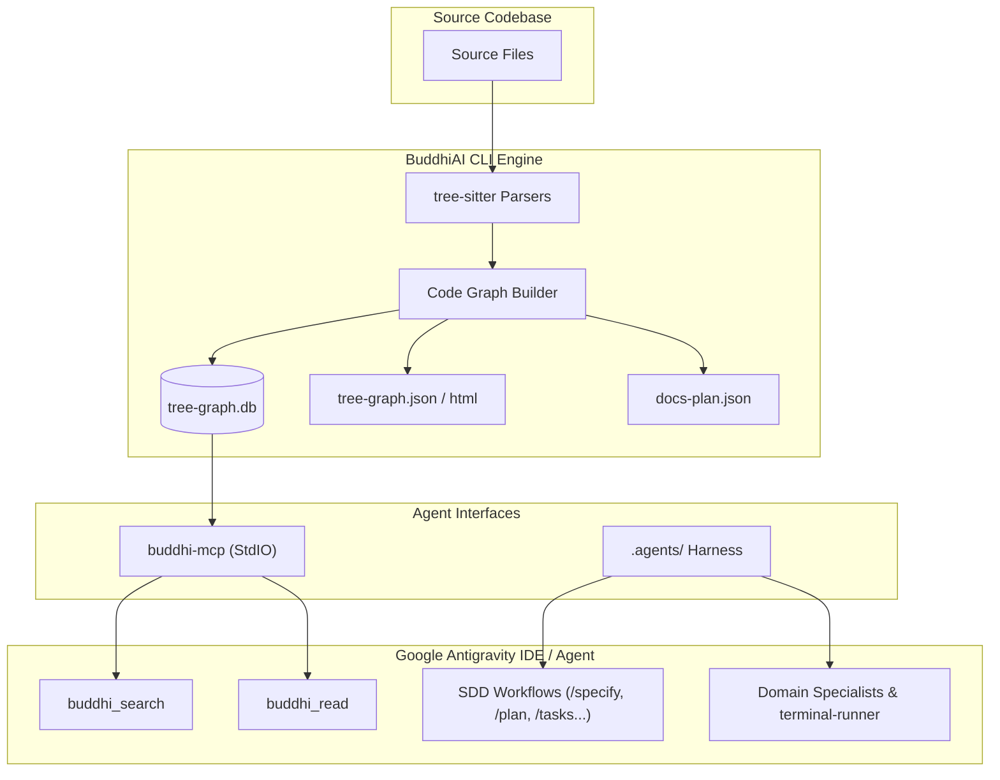

**BuddhiAI CLI** turns any software codebase into what an AI coding agent actually needs:
- A **code graph** detailing files, directories, classes, functions, and methods along with their containment, import, and call relationships via tree-sitter.
- A **Model Context Protocol (MCP) server** (`buddhi-mcp`) providing topology-driven search and compressed, AST-pruned file reading.
- A fully scaffolded **Google Antigravity agent harness** grounded in that code graph.
- A complete **Spec-Driven Development (SDD)** lifecycle workflow grounded in open standards like [AGENTS.md](https://agents.md/).

---

## Core Value Proposition

Traditional AI coding assistants rely on basic keyword grep, lexical search, or massive brute-force context stuffing. When working on large codebases, this exhausts context windows, loses structural relationships, and leads to hallucinations.

BuddhiAI CLI solves this by providing:

1. **Topology-Driven Context**: Maps dependencies, call hierarchies, and structural bridges so agents understand *what calls what* before touching code.
2. **Dynamic AST Compression**: Reads source code through intelligent compression modes (`auto`, `signatures`, `map`, `entropy`, `full`) within strict character and token budgets.
3. **Open Knowledge Format (OKF) Codebase Docs**: Documents symbols bottom-up in dependency order, maintaining content hashes for staleness detection.
4. **Spec-Driven Development (SDD)**: Enforces rigor through formalized specification (`/specify`), architecture planning (`/plan`), task breakdown (`/tasks`), implementation (`/implement`), and evidence-based verification (`/verify`).

---

## Architecture Overview

---

## Supported Languages

BuddhiAI CLI parses and constructs AST relationships across modern development stacks:

- **Python** (`.py`)
- **JavaScript** (`.js`, `.jsx`, `.mjs`, `.cjs`)
- **TypeScript** (`.ts`, `.tsx`)
- **Go** (`.go`)
- **Rust** (`.rs`)
- **C#** (`.cs`)
- **Java** (`.java`)
- **Kotlin** (`.kt`, `.kts`)
- **Swift** (`.swift`)

---

## What BuddhiAI CLI Scaffolds

When you run `buddhi init` in your repository, it generates:

| Artifact / Path | Description |
| :--- | :--- |
| `AGENTS.md` | Standard project conventions, commands, and non-negotiable guidelines for AI agents at repository root. |
| `.buddhi/graphs/tree-graph.db` | SQLite database indexing `nodes` and `edges` for fast CTE queries (call hierarchy, callers/callees). |
| `.buddhi/graphs/tree-graph.json` | Cytoscape.js compatible graph format. |
| `.buddhi/graphs/tree-graph.html` | Interactive graph visualization viewer viewable in any browser. |
| `.buddhi/docs-plan.json` | Staleness-aware dependency documentation roadmap. |
| `.agents/mcp_config.json` | Model Context Protocol configuration auto-connecting Antigravity to `buddhi-mcp`. |
| `.agents/` | Google Antigravity harness: slash workflows, specialist subagents, rules, skills, and memory index. |

---

## Next Steps

- Proceed to [Installation Guide](/cli/installation/) to install the CLI and MCP extras.
- Explore the [Commands Reference](/cli/commands/) to learn `buddhi init`, `generate`, `mcp`, and `sdd`.
- Check out the [MCP Server & Tools](/cli/mcp-server/) for details on `buddhi_search` and `buddhi_read`.
- Discover the [Antigravity Agent Harness](/cli/agent-harness/) to master the SDD agent workflows.
