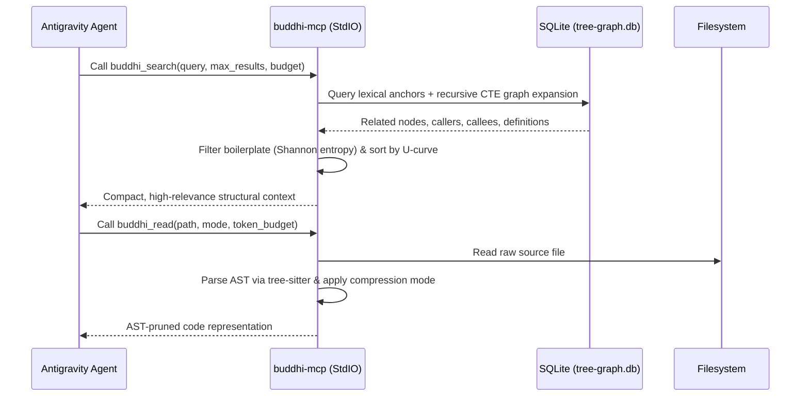

The **Buddhi Model Context Protocol (MCP) Server** (`buddhi-mcp`) provides AI coding agents with a structured, topology-aware interface to understand, navigate, and read codebases without overflowing context windows.

---

## Why MCP for Codebases?

LLM context windows are precious and prone to retrieval degradation when overloaded with hundreds of raw files. Rather than relying on simple text grep, `buddhi-mcp` connects agents directly to the AST-indexed SQLite code graph and provides two specialized tools:

1. **`buddhi_search`**: Topology-aware code search with community expansion and entropy filtering.
2. **`buddhi_read`**: Dynamic, AST-pruned file reader with token budgeting and multiple compression modes.

---

## Server Architecture & Transport

`buddhi-mcp` runs locally as a child process using the **StdIO** transport:



---

## Workspace Integration

When you run `buddhi init`, it automatically creates `.agents/mcp_config.json` inside your project:

```json
{
  "mcpServers": {
    "buddhi-mcp": {
      "command": "buddhi-mcp",
      "args": [
        "--root",
        "."
      ]
    }
  }
}
```

Google Antigravity detects this configuration upon opening the workspace, making the tools available to all workflows and subagents.

---

## Tool Reference: `buddhi_search`

Performs structural, topology-driven search across the repository.

### Signature & Arguments

| Parameter | Type | Required | Description |
| :--- | :--- | :--- | :--- |
| `query` | `string` | **Yes** | Symbol name, function name, class, or keyword to search for. |
| `max_results` | `integer` | No | Maximum number of primary nodes to return (default: `10`). |
| `budget` | `integer` | No | Maximum character budget allocated for the search result. |
| `include_signatures` | `boolean` | No | Whether to include extracted method signatures for found nodes. |

### How the Algorithm Works

1. **Lexical Anchoring**: Locates seed nodes matching the query in symbol definitions and file paths.
2. **Graph Expansion**: Traverses edges in `tree-graph.db` to locate callers, callees, parent classes, and bridge nodes within the graph neighborhood.
3. **Entropy Filtering**: Evaluates Shannon entropy on candidate snippets to eliminate autogenerated boilerplate, large static lookup tables, and repetitive noise.
4. **U-Curve Positional Layout**: Sorts results so the most vital structural anchors appear at the start and end of the output, countering the LLM "lost in the middle" attention phenomenon.

---

## Tool Reference: `buddhi_read`

Reads source files with AST-pruning and compression to preserve context tokens.

### Signature & Arguments

| Parameter | Type | Required | Description |
| :--- | :--- | :--- | :--- |
| `path` | `string` | **Yes** | Relative path to the file in the workspace. |
| `mode` | `string` | No | Compression strategy: `auto`, `signatures`, `map`, `entropy`, `full`. Default: `auto`. |
| `token_budget` | `integer` | No | Target token budget. Compression level increases if file exceeds budget. |
| `focus_lines` | `string` | No | Optional range (e.g. `45-80`) to keep full detail while compressing surrounding context. |

### Compression Modes

| Mode | Description | Best For |
| :--- | :--- | :--- |
| `auto` | Dynamically selects the highest fidelity mode that fits within `token_budget`. | General agent reading. |
| `signatures` | Retains file header, imports, classes, and function/method signatures while stripping implementation bodies (`...`). | Understanding API contracts without seeing internal code. |
| `map` | Produces an outline map of all classes, functions, and line ranges. | Navigating large files (1,000+ LOC). |
| `entropy` | Preserves non-repetitive blocks with high informational density while condensing boilerplate. | Analyzing algorithmic routines. |
| `full` | Returns the raw, uncompressed source code. | Making precise line edits or viewing small files (<200 LOC). |

### Example: Signatures Mode Output

When reading a 500-line Python service with `mode: "signatures"`:

```python
# [Buddhi AST Compressed: signatures mode]
class OrderService:
    def __init__(self, db: DatabaseClient, cache: CacheProvider) -> None: ...
    def create_order(self, customer_id: str, items: list[OrderItem]) -> Order: ...
    def cancel_order(self, order_id: str, reason: str) -> bool: ...
    def calculate_tax(self, subtotal: Decimal, state: str) -> Decimal: ...
```

The agent receives the entire public interface in just 50 tokens instead of consuming 1,200 tokens reading function bodies.

---

## Manual Testing of MCP Tools

You can verify the MCP server directly from your terminal using Python or standard MCP inspection clients:

```sh
# Start the MCP server interactive StdIO session
buddhi mcp --root .
```
