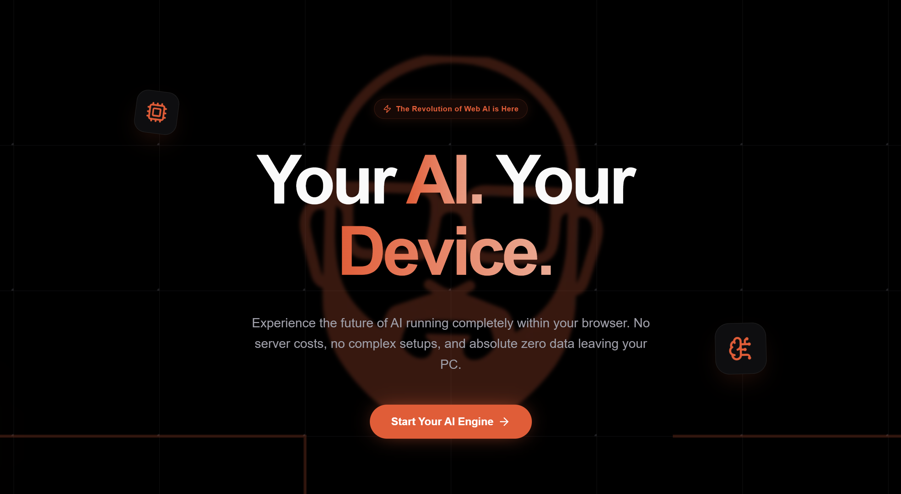
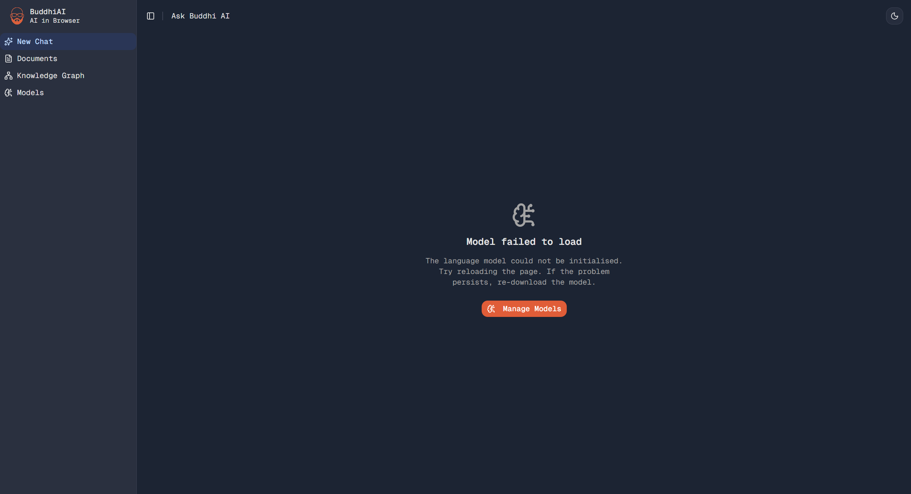
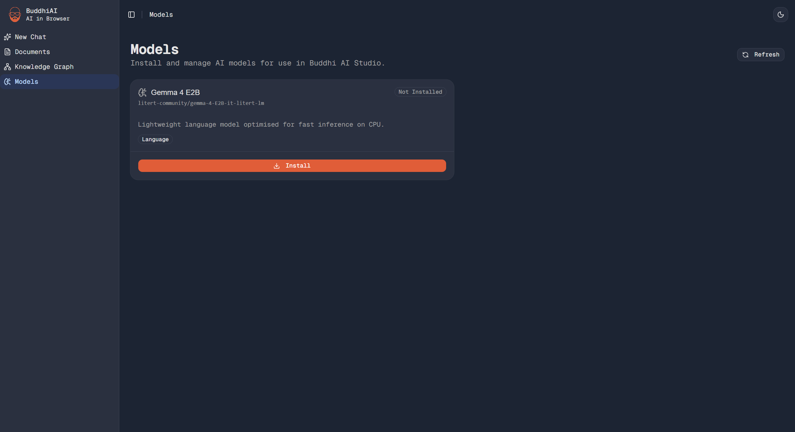

BuddhiAI is a client-side, privacy-first AI platform that runs large language models and document retrieval workflows directly inside your web browser without sending your data to external servers.

## Overview & Key Capabilities

- **100% In-Browser Execution**: Inference and embeddings run on client-side hardware.
- **Powered by Google Gemma 4**: Integrated with the Gemma 4 E2B model and EmbeddingGemma 300m.
- **Reasoning / Thinking Mode**: Toggleable chain-of-thought reasoning for complex problem-solving.
- **Client-Side RAG (Retrieval-Augmented Generation)**: Upload personal documents to chat with your files locally.

## Getting Started & Setup

### Step 1: Access the Application

1. Open your web browser and navigate to the [BuddhiAI Web App](https://ai.buddhilive.com).
2. Click the "Start" call-to-action button to launch the application interface.

### Step 2: Download & Initialize Models

On your first visit, the models must be downloaded and cached locally in your browser storage:

1. If you see a Model loading failed prompt, click the "Manage Models" button to open the Model Manager.
2. Locate the required models:
   - Gemma 4 E2B (LLM for generation and chat)
3. Click Download to download the model.
4. Allow the download and initialization to complete in the background.

